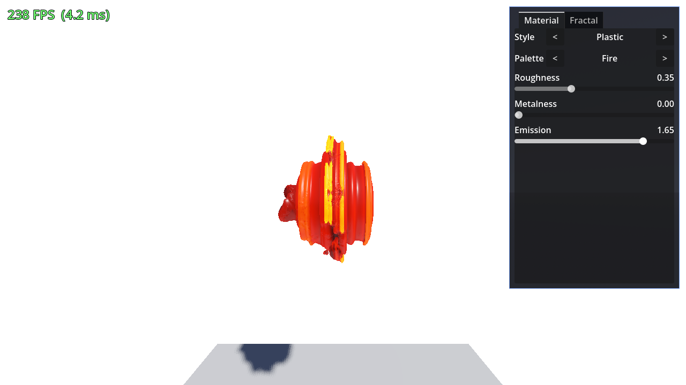
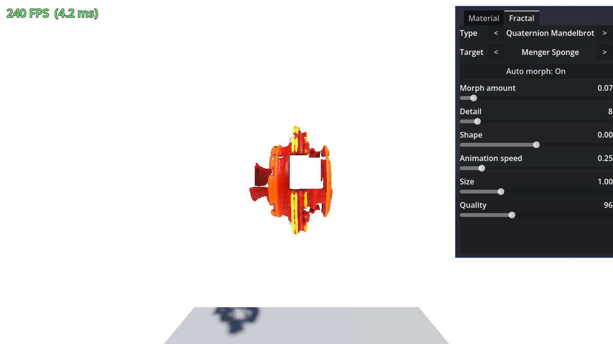

# vrqf



**vrqf** is an experimental VR quaternion fractal explorer built with **Godot**, **C#**, **OpenXR**, and custom GPU shaders.

The project renders one animated 3D fractal in a VR or desktop scene. It cycles through quaternion Julia-style fractals, Mandelbulb variants, iterated function systems, and other forms, with live controls for morphing, shape, palettes, and materials.

## What it does

`vrqf` renders raymarched 3D fractals in real time and places them inside an interactive VR environment.

The project includes:

* A VR fractal viewer using Godot and OpenXR
* A custom spatial shader for raymarched 3D fractals
* Quaternion-based fractal formulas
* Multiple fractal types
* Morphing between fractal formulas
* Palette and material switching
* Live parameter adjustment from the desktop panel, VR wrist menu, controllers, or keyboard
* One large fractal that automatically morphs through the available types
* Adjustable roughness, metalness, and emission with settings remembered for each material
* Experimental reflective, emissive, plastic, metal, glass, and matcap-style materials

## Fractals included

The shader currently supports a range of fractal and procedural distance-estimated forms:

* Quaternion Julia
* Mandelbulb
* Quaternion Mandelbrot
* Menger Sponge
* Sierpinski Tetrahedron
* Burning Ship
* Mandelbox
* Tricorn
* Nova
* Apollonian
* Kaleidoscopic IFS
* Octahedral IFS
* Gyroid
* Schwarz P
* Mandelbulb P3
* Cubic Julia

## Why this exists

This project is a graphics and spatial-maths experiment.

The goal is to explore how abstract mathematical structures can be represented as navigable 3D objects in VR. It combines several areas of interest:

* computational geometry
* raymarching
* fractal distance estimation
* quaternion maths
* procedural rendering
* real-time shader programming
* VR spatial interaction

It is not intended to be a polished product. It is a technical and visual experiment.

## Technology

* Godot 4.7 with C#/.NET support
* C#
* OpenXR
* Godot spatial shaders
* GPU raymarching
* VR controller input
* Procedural material rendering

## Controls

The project supports desktop controls and VR controller input. On desktop, use the panel in the upper-right corner. Its **Material** tab selects a style and palette and adjusts roughness, metalness, and emission. Its **Fractal** tab selects the current type and morph target, pauses or resumes automatic morphing, and adjusts morph amount, detail, shape, animation speed, size, and quality. Material edits are remembered when you switch styles. Roughness and metalness apply to Plastic, Metal, and Glass; emission applies to every style.



### VR controls

| Action                | Control           |
| --------------------- | ----------------- |
| Next fractal          | A / X             |
| Previous fractal      | B / Y             |
| Change material       | Right stick click |
| Change palette        | Left stick click  |
| Select live parameter | Grip              |
| Adjust live parameter | Triggers          |
| Toggle auto morph     | Wrist menu button |

The wrist menu has **Fractal**, **Morph**, and **Material** tabs, including step controls for roughness, metalness, and emission.

### Keyboard controls

| Action                      | Key |
| --------------------------- | --- |
| Next fractal                | `F` |
| Previous fractal            | `G` |
| Change material             | `T` |
| Change palette              | `P` |
| Next live parameter         | `]` |
| Previous live parameter     | `[` |
| Increase selected parameter | `=` |
| Decrease selected parameter | `-` |
| Change morph target         | `M` |
| Increase morph amount       | `.` |
| Decrease morph amount       | `,` |
| Toggle automatic morphing   | `Space` |
| Randomise                   | `R` |

The fractal cycles through types automatically. Adjusting the morph amount manually pauses the cycle; press `Space` or the Auto morph button in either panel to resume it.

Movement uses the standard WASD-style bindings:

| Action               | Key   |
| -------------------- | ----- |
| Move forward         | `W`   |
| Move back            | `S`   |
| Move left            | `A`   |
| Move right           | `D`   |
| Move up              | `E`   |
| Move down            | `Q`   |
| Toggle mouse capture | `Esc` |

The pointer starts visible so you can use the panel. Click the scene to capture it for mouse look, then press `Esc` to release it.

## How it works

The fractal surface is generated in a shader using distance estimation and raymarching.

Rather than storing a mesh for each fractal, the shader evaluates a mathematical distance function repeatedly along a ray. When the ray gets close enough to the fractal surface, the shader treats that as a hit and shades the result.

At a high level:

1. A ray is generated from the camera through the rendered object.
2. The ray is marched through a bounded volume.
3. A distance estimator tells the shader how far it can safely step.
4. When the ray approaches the fractal surface, a hit is recorded.
5. A normal is estimated from nearby distance samples.
6. The surface is shaded using the selected material and palette.
7. Depth is written so the fractal correctly interacts with the rest of the scene.

The project uses object-space calculations so the fractal remains anchored correctly in the world as the player moves around it.

## Single-fractal mode

The scene displays one interactive fractal. Its shader blends the current type's distance estimate with the next type's distance estimate over three seconds, then continues through the available types. You can choose a type, target, palette, material, and live parameters at any time.

## Project structure

```text
vrqf/
├── project.godot
├── scenes/
│   └── main.tscn
├── scripts/
│   └── FractalController.cs
├── shaders/
│   └── quaternion_julia.gdshader
└── textures/
    ├── palette_fire.tres
    ├── palette_ice.tres
    ├── palette_rainbow.tres
    └── palette_viridis.tres
```

## Running the project

1. Install Godot 4.7 with C#/.NET support and the .NET 10 SDK.
2. Clone the repository.
3. Open the project in Godot.
4. Ensure OpenXR is available if running in VR.
5. Run the main scene.

The project also runs in desktop mode without an OpenXR runtime. The desktop panel appears automatically when OpenXR is unavailable.

## Notes

This is an experimental project and may require adjustment depending on:

* Godot version
* OpenXR runtime
* VR headset
* GPU capability
* shader compatibility
* platform-specific XR setup

The shader is computationally heavy, especially while it evaluates two fractal types during a morph. Quality, iteration count, and raymarch step count may need to be reduced on lower-end hardware.

## Areas for future improvement

Possible next steps:

* Add proper in-world UI documentation
* Add presets for interesting fractal states
* Save and load favourite configurations
* Add performance quality profiles
* Add hand/controller interaction for grabbing and scaling fractals
* Add more fractal formulas
* Add automated export of still images
* Add explanatory notes for the maths behind each fractal

## Status

Experimental / prototype.

This project exists as a hands-on exploration of VR, shader programming, quaternion fractals, and real-time spatial rendering.
